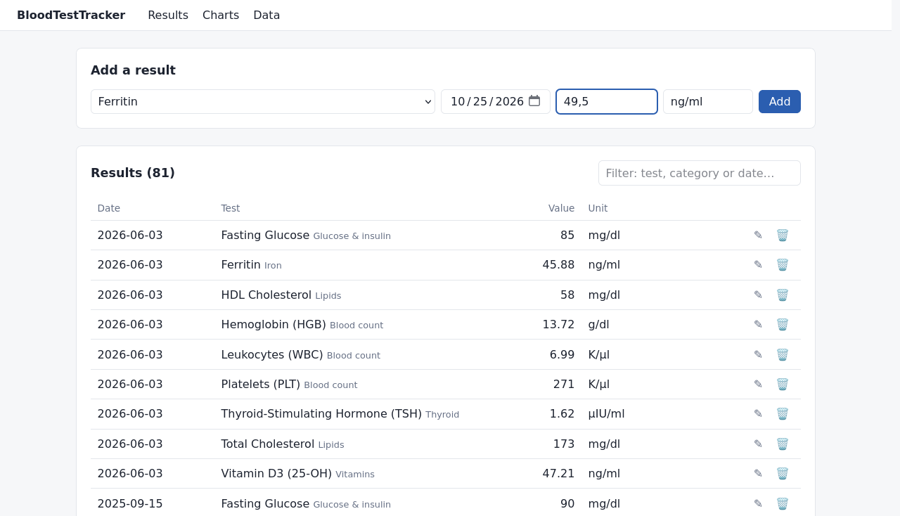
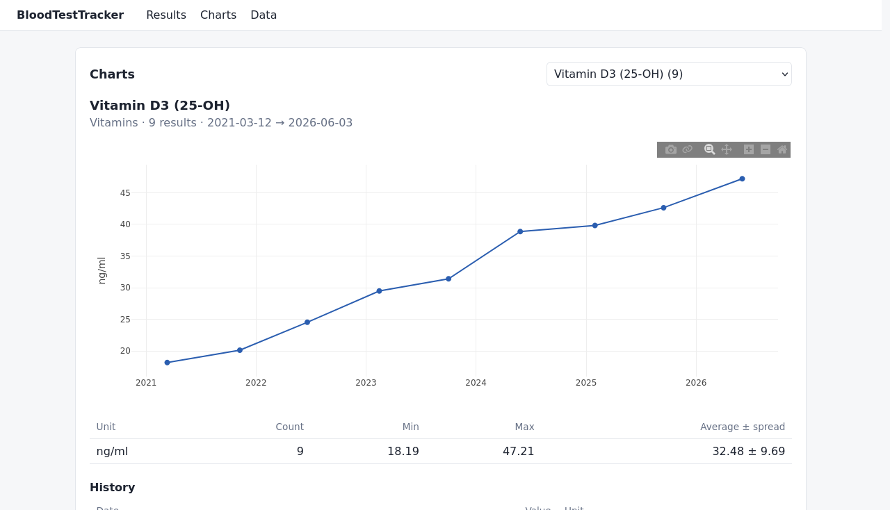

# BloodTestTracker

A private, local app for keeping track of your blood test results over time. Add results as you get them, browse and filter your history, and see each test as an interactive chart with statistics.

It runs entirely on your own computer, in your browser: nothing is sent anywhere, and nothing is loaded from the internet.




<sub>Screenshots use made-up demo values.</sub>

## Features

- **Results:** add, edit and delete results; the unit fills in when you pick a test; decimal commas (`13,5`) and bounds like `<0.5` are accepted; filter the table by test, category or date
- **Charts:** one interactive chart per test (hover for values, drag to zoom) with count, min, max and average; results recorded in different units are shown as separate lines with separate statistics
- **Test catalog:** 73 common blood tests in 11 categories (blood count, iron, lipids, thyroid, …)
- **Data:** export everything to CSV, and automatic database backups every time the app starts

## Requirements

- Python 3.10 or later
- Tested on Linux Mint; should work anywhere Python runs

## Installation

```bash
git clone https://github.com/nataliarogoza/BloodTestTracker.git
cd BloodTestTracker
python3 -m venv .venv
.venv/bin/python -m pip install -e .
```

## Running

```bash
.venv/bin/python -m bloodtracker
```

Your browser opens at <http://127.0.0.1:8000>. Stop the app with **Ctrl+C** in the terminal (Ctrl+Z only pauses it, and keeps the port busy).

Add `--no-browser` to start without opening a tab.

## Your data

| What | Where |
|---|---|
| Database | `data/tracker.db` in the project folder |
| Backups | `BloodTestTracker_backups/`, next to the project folder |

Both are created on first use, and neither is ever committed to git (`data/` is in `.gitignore`).

**Backups** happen automatically every time the app starts, whenever something changed since the last backup. The newest 30 automatic backups are kept. Backups made with the **Back up now** button on the Data page, and those made automatically before an upgrade changes the database structure, are never deleted.

**To restore a backup:** stop the app, copy the backup file over `data/tracker.db`, and start the app again. The Data page shows the exact command.

Backups live on the same disk as the app, so they protect against mistakes and a damaged database, not against the disk failing. To keep copies elsewhere, point the backups folder at a synced folder (see Settings).

**CSV export:** the Data page downloads all results as a CSV file (comma-separated, decimal dots). In Excel set to Polish, open it with *Data → From Text/CSV* and choose comma as the separator.

## Settings

Optional environment variables, set when starting the app:

| Variable | Default | Purpose |
|---|---|---|
| `BLOODTRACKER_DB` | `data/tracker.db` | Database file |
| `BLOODTRACKER_BACKUP_DIR` | `../BloodTestTracker_backups` | Backups folder |
| `BLOODTRACKER_PORT` | `8000` | Port the app listens on |

For example, to try things out on a copy of your data:

```bash
cp data/tracker.db /tmp/tracker-copy.db
BLOODTRACKER_DB=/tmp/tracker-copy.db .venv/bin/python -m bloodtracker
```

## Privacy and security

- The app only listens on `127.0.0.1`, so other devices on your network can't reach it.
- It only answers requests addressed to `127.0.0.1` / `localhost`, and only accepts changes coming from its own pages, so other websites open in your browser can't read or change your data.
- All scripts it uses (HTMX, Plotly) are stored in the project, so it works offline and no outside server sees when you use it.
- It doesn't keep copies of your pages in the browser's storage.

## Upgrading from the old version (PyQt + PostgreSQL)

The first version of this app was a desktop app that stored results in PostgreSQL. To copy your results from it, run this **once**, from the project folder, with the old app's `.env` file still in place:

```bash
.venv/bin/python -m pip install -e ".[migrate]"
.venv/bin/python -m bloodtracker.legacy_import
```

PostgreSQL is only read, never changed. Every result is checked after copying, and nothing is saved unless they all match. The import refuses to run twice.

## Development

```bash
.venv/bin/python -m pip install -e ".[dev]"
.venv/bin/python -m pytest
```

Tests use temporary databases and backup folders, so they never touch your real data.

| Path | What's there |
|---|---|
| `bloodtracker/app.py` | Web pages and routes |
| `bloodtracker/services.py` | Adding, editing, deleting, statistics, CSV export |
| `bloodtracker/db.py` | Database connection, migrations, backups |
| `bloodtracker/migrations/` | Numbered SQL files that build and upgrade the database |
| `bloodtracker/templates/` | HTML pages (Jinja2) and the pieces HTMX swaps in |
| `bloodtracker/static/` | CSS, JavaScript, and the bundled HTMX and Plotly |
| `bloodtracker/legacy_import.py` | One-time import from the old PostgreSQL version |
| `tests/` | Automated tests (pytest) |

Built with [FastAPI](https://fastapi.tiangolo.com), [SQLite](https://sqlite.org), [Jinja2](https://jinja.palletsprojects.com), [HTMX](https://htmx.org) and [Plotly.js](https://plotly.com/javascript/). Versions and licenses of the bundled scripts are listed in [`bloodtracker/static/js/VENDOR.md`](bloodtracker/static/js/VENDOR.md).

## History

Version 1 was a Linux desktop app built with PyQt and PostgreSQL - my first application. In 2026 it was rebuilt as this local web app: no database server to install, interactive charts, and automatic backups. The desktop version is still in the git history (commit `0364fdf`).

## License

MIT - see [LICENSE](LICENSE).
